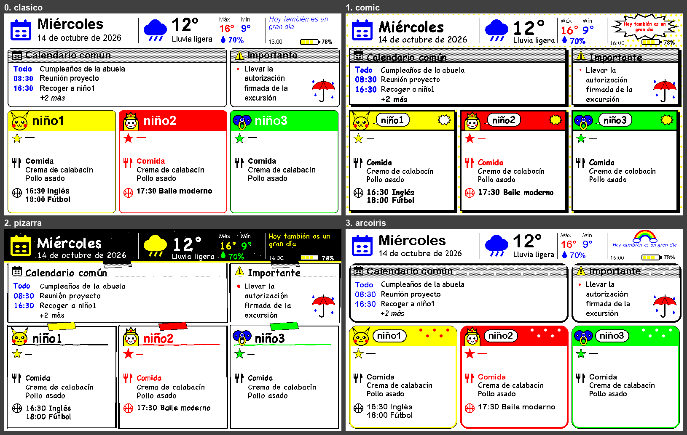
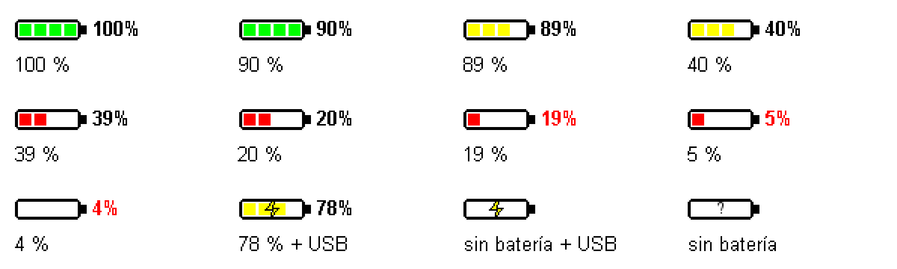

# Diseño del dashboard

Panel 800×480 con solo las 6 tintas del Spectra 6 (negro, blanco, amarillo, rojo, azul,
verde): nada de pasteles ni grises, que el dither convierte en ruido. Texto sin antialiasing
(`d.fontmode = "1"`). Código en `server/render.py` (layout + temas) y `server/icons.py`; los datos llegan como un
`dict` (ver `render.fixture()`), que en el repo original rellenan fuentes propias (tiempo, calendario,
menú, actividades) no incluidas aquí.

## Zonas
| y (px) | Zona | Datos |
|---|---|---|
| 0–78 | Cabecera: fecha (etiqueta "MAÑANA" desde las 20 h), tiempo, máx/mín/lluvia, frase, hora y batería | tiempo (p. ej. Open-Meteo), frase del día |
| 82–222 | Izquierda (2/3, x 8–528): **Calendario común**: hoy y mañana (viernes: hasta el domingo; domingo: domingo y lunes); los días siguientes llevan el día delante ("Sáb 10:00", "Sáb" si es de todo el día); sin emojis; 4 filas; "+N más". Derecha (1/3, x 536–796): **Importante** (mensajes con viñeta; "Sin avisos"; paraguas de 62 px en la esquina inferior derecha si ese día llueve: icono lluvia/tormenta o probabilidad ≥ 50 %, `render.rainy()`). Títulos de las dos cajas en gris, simulado con una trama de puntos negros (`grey()` en `render.py`; el panel no tiene gris) | calendario compartido, avisos |
| 230–474 | Tres tarjetas de niños (texto 18 px; ropa y piscina 22 px): Ropa + piscina, Comida, actividades (sin título, en negrita; si no hay, no sale) | menú del comedor, actividades |

## Estilos
Cada estilo es una subclase de `Theme` en `render.py` (fuentes, colores de cabecera,
`card()`, `kid_name()`, `motto()`, `background()`); el layout es común.
El clásico es la referencia y no debe cambiar al tocar los demás.

| Estilo | Idea | Fuentes macOS |
|---|---|---|
| `clasico` | Tarjetas redondeadas con cabecera de color sólido. | Arial |
| `comic` | Fondo de puntos amarillos, bordes gruesos con sombra negra, nombres en bocadillo, frase en explosión "POW". | Comic Sans MS |
| `pizarra` | Cabecera de pizarra negra con tiza, tarjetas como notas con celo de color y borde a mano. | Chalkboard SE |
| `arcoiris` | Tarjetas muy redondeadas con lunares, nombres en pegatina, arcoíris sobre la frase. | Arial Rounded Bold, Trebuchet MS |

Ver uno sin cambiar el panel:
`cd server && .venv/bin/python render.py --fixture --estilo comic comic.png`.

## Iconos
Dibujados con primitivas de Pillow en `icons.py` (calendario, tiempo, persona, cubiertos,
balón, estrella, aviso, Pikachu, princesa, chupete, uniforme, chándal). Un PNG en `server/assets/<nombre>.png`
sustituye al dibujado.

Batería (`icons.battery`, 48×14 px, cuadrados de 8 px; `icons.battery_segments`): 4 verdes
≥ 90 %, 3 amarillos 40–89 % (el panel no tiene naranja), 2 rojos 20–39 %, 1 rojo 5–19 %, vacía
< 5 %; porcentaje en rojo < 20 %; rayo con USB; "?" sin dato (`bat=-1`).

